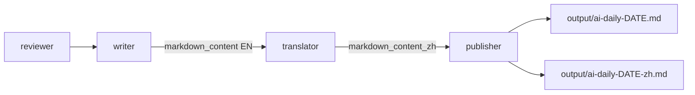
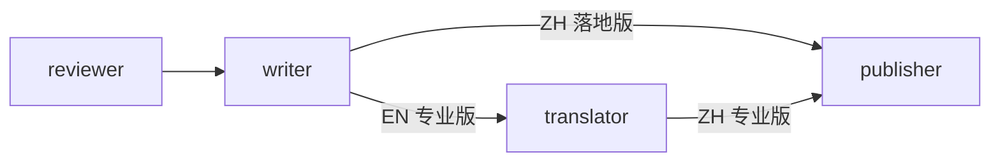

# 双版本日报：专业版 + 开发落地版

- **日期**：2026-09-06
- **状态**：方案已定，待实施
- **范围**：在保留现有专业简报的同时，新增中文「开发落地版」并单独落盘

---

## 1. 决策

- **专业版**：保持现状——英文 `WRITER_PROMPT` 产出 + 现有中文翻译。
- **落地版**：用「人话 + 怎么做」风格，**直接用中文生成**（不先英后译），语气口语、有技术点、每条带可操作场景。
- 每次流水线**默认两版都出**；落地版失败不影响专业版发布。

---

## 2. 现状



写稿入口在 [`src/agents/writer.py`](../src/agents/writer.py)；模型字段在 [`src/models.py`](../src/models.py) 的 `GeneratedArticle`；落盘在 [`src/publishers/markdown.py`](../src/publishers/markdown.py)。

---

## 3. 目标产出

| 文件 | 内容 |
|------|------|
| `output/ai-daily-YYYY-MM-DD.md` | 专业英文版（不变） |
| `output/ai-daily-YYYY-MM-DD-zh.md` | 专业中文翻译（不变） |
| `output/ai-daily-YYYY-MM-DD-dev.md` | **新**：中文开发落地版 |

落地版条目结构（每条约 3–4 行）：

1. **标题**（保留模型/产品名原文）
2. **【人话版】** 大白话 + 比喻
3. **【开发能用上】** `如果你的 Agent/项目中遇到[XX]，可以用这个办法[YYY]`
4. 保留 `AI 评分` + 原文 URL
5. 文末 **开发趋势总结** 1–2 句

---

## 3.5 落地版筛选规则（写进 DEV_WRITER_PROMPT）

落地版面向「标准业务 Agent 开发者」，不面向「机器学习研究员/算法工程师」。在生成正文前，先用下面三步对每条候选新闻做取舍。本节优先级高于第 3 节的条目写作风格。

### 分类

判断每条新闻本质属于哪一类：

- **A 类·业务 Agent 工程**：编排、工具调用、记忆、RAG、Prompt 工程、MCP、安全护栏、可观测性、部署运维
- **B 类·模型/算法**：后训练、微调、对齐、注意力机制改进、形式化证明、神经编译、经验回放、奖励建模
- **C 类·基础设施**：推理加速、KV 缓存、显存优化、运行时、向量库、沙盒环境

### 取舍

- **A 类**：默认收录，必须给出「开发能用上」可操作句式。
- **C 类**：仅当对标准 Agent 运行时/部署有直接收益时收录（如 KV 驱逐省显存、沙盒复用减成本）。
- **B 类**：默认筛除。理由——**标准业务 Agent 开发 ≠ 机器学习模型训练**。
  - 例外：仅当读者团队计划「私有化开源模型 + 微调」时才有落地价值，此时在条目末尾追加一行 `⚠️ 适用前提：团队有私有化/微调计划，否则可跳过`，并把「开发能用上」改成「如果你要做模型私有化微调，可以用这个办法……」。

### 兜底

- 被筛除的 B 类条目不进正文，但在文末「已筛除条目说明」段里点名存在，让读者知道是被过滤而非漏看。
- 当日筛除数 ≥ 条目一半时，在「开发趋势总结」里提示「今日偏算法侧，业务 Agent 落地条目较少」。

### 文末固定段

落地版文末除 `## 开发趋势总结` 外，恒定追加一段：

```
## 已筛除条目说明
今日共有 N 条属模型训练/算法范畴（后训练、微调、对齐、形式化证明等），
对标准业务 Agent 开发迭代无直接落地价值，已从正文筛除。
如团队有"私有化开源模型 + 微调"计划，可回看专业版 -zh.md 获取详情。
```

### 正反示例（few-shot）

- ✅ **收录（A 类）**：完整的 Claude Code 配置——业务 Agent 工程类（编排/钩子/MCP），默认收录，「开发能用上：如果你的 Agent 用 Claude Code 做多智能体编排……」
- ⚠️ **条件收录（C 类）**：随机 KV 缓存驱逐器——基础设施类，但能让长推理 Agent 省显存、涨吞吐，收录。
- ❌ **默认筛除（B 类）**：BCIT 后训练经验迁移——属 LLM 后训练范畴，标准业务 Agent 开发不涉及，不进正文，仅在文末筛除说明里点名。
- ⚠️ **B 类例外**：自然语言编译为本地神经函数——属模型/算法类，但产出是「本地可跑的小适配器」，若团队计划私有化部署+微调才有价值，收录但在末行追加 `⚠️ 适用前提：团队有私有化/微调计划，否则可跳过`。

---

## 4. 实现步骤

### 4.1 扩展文章模型

在 [`src/models.py`](../src/models.py) 的 `GeneratedArticle` 增加：

- `markdown_content_dev: str = ""`
- `description_dev: str = ""`（可选，给站点列表用）

### 4.2 Writer 增加第二路生成

在 [`src/agents/writer.py`](../src/agents/writer.py)：

- 新增 `DEV_WRITER_PROMPT`（中文），固化要求：人话、可操作场景、轻松语气、每条短、文末趋势总结；输入仍用已评分的 `ExtractedItem` JSON（title/summary/ai_score/ai_reason/url/source）。
- 在 `writer_node` 里：专业版写完后，再调一次 LLM 生成落地版；失败只打 warning，专业版照常返回。
- 降级模板 `_build_fallback_dev_markdown`：无 LLM 时用 `summary + ai_reason` 拼出简版落地稿，保证文件仍产出。

### 4.3 Publisher 落盘落地版

在 [`src/publishers/markdown.py`](../src/publishers/markdown.py) 的 `publish_node`：若有 `markdown_content_dev`，写：

`ai-daily-{date}-dev.md`

frontmatter 示例：`lang: zh-dev`、`title`、`description`。邮件/Webhook **仍只推专业英文版**（避免渠道刷屏）；落地版仅本地/站点文件。

### 4.4 工作流

不必改图拓扑：落地版挂在现有 `writer` 节点内完成即可（translator 不碰落地版）。



### 4.5 测试

- 单测：落地版 prompt 模板字段齐全；fallback 含「人话」「开发能用上」「趋势总结」。
- 不强制跑完整 LLM 流水线。

---

## 5. 关键文件

- [`src/models.py`](../src/models.py)
- [`src/agents/writer.py`](../src/agents/writer.py)
- [`src/publishers/markdown.py`](../src/publishers/markdown.py)
- `tests/test_writer.py`（补充落地版 fallback 断言）
