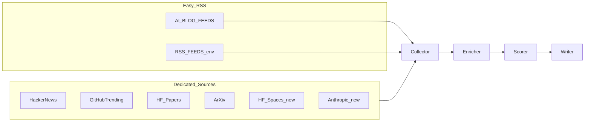

# 新资讯源接入方案

- **日期**：2026-09-06
- **状态**：调研完成，分阶段实施
- **范围**：大厂博客 / 论文开源 / 海外社区 / 国内媒体 / 简报站的接入方式评估

---

## 1. 现有接入能力（不必重造）

流水线已有两条扩展路径：

1. **RSS 通用通道**：`src/sources/rss_generic.py` 的 `AI_BLOG_FEEDS` + `.env` 的 `RSS_FEEDS=name=url,...`，经 `SOURCE_REGISTRY["rss"]` 进入 collector。
2. **专用 Source**：如 `src/sources/hackernews.py`、`src/sources/github.py`、`src/sources/huggingface_papers.py`，在 `src/agents/collector.py` 注册后，由 `scripts/run_pipeline.py` 默认源列表启用。

默认跑：`hackernews`、`github`、`huggingface`、`arxiv`、`rss`（不含 Reddit / Twitter / Product Hunt）。

---

## 2. 各站点可达性（2026-09-06 实测）

| 分类 | 站点 | 接入方式 | 结论 |
|------|------|----------|------|
| 已有 | OpenAI / DeepMind / HF Blog / PyTorch | 内置 RSS | 已接通；OpenAI 实际跳转到 `https://openai.com/news/rss.xml` |
| 已有 | ArXiv / GitHub Trending / HF Papers / HN | 专用源 | 已接通 |
| 易 | AWS Blog | `https://aws.amazon.com/blogs/aws/feed/` | 直接 RSS；内容偏全 AWS，靠现有 AI filter/scorer 筛 Bedrock/AI |
| 易 | Dev.to AI | `https://dev.to/feed/tag/ai` | 直接 RSS |
| 易 | Towards Data Science | `https://towardsdatascience.com/feed/` | 直接 RSS |
| 易 | InfoQ 中文 | `https://www.infoq.cn/feed` | 全站 feed 可用；无独立 AI 专题 feed，靠 LLM 过滤 |
| 易 | 掘金 | `https://juejin.cn/rss` | 全站 feed；无稳定 AI 标签 RSS |
| 易 | ByteByteGo | `https://blog.bytebytego.com/feed` | Substack RSS |
| 易 | Developers Digest | `https://www.developersdigest.tech/feed.xml` | RSS 可用（路径是 `/feed.xml`） |
| 易 | Kenashe | `https://kenashe.ai/rss.xml` | RSS 可用 |
| 中 | Anthropic News | 无 RSS（`/rss.xml` 404） | 解析 `sitemap.xml` 或新闻列表 HTML → 新 `AnthropicSource` |
| 中 | HF Spaces | `GET https://huggingface.co/api/spaces?limit=N` | JSON API，按 `trendingScore` 排序 → 新 `HuggingFaceSpacesSource` |
| 难/缓 | 机器之心 | `/rss` 跳到 data-service 页 | 需反爬/浏览器，暂缓 |
| 难/缓 | The Batch | 仅 HTML/邮件周刊 | 需页面解析，暂缓 |
| 难/缓 | Futurepedia / AITools 类目录 | SPA / 域名异常 | 暂缓；aitools.io 实测不可靠 |
| 跳过 | AITools 失效域名 | — | 不做 |

**不需要 SerpAPI / Browserless** 就能完成「易 + 中」两档；难档才可能需要无头浏览器，当前不做。

---

## 3. 推荐实施（分阶段、控成本）

### Phase 1 — 扩展内置 RSS（改配置即可）

更新 `src/sources/rss_generic.py` 的 `AI_BLOG_FEEDS`：

- 保留并校正：`openai_blog` → `https://openai.com/news/rss.xml`
- 保留：`deepmind_blog`、`huggingface_blog`、`pytorch_blog`
- 新增：`anthropic` 暂不放 RSS；先加  
  `aws_blog`、`devto_ai`、`towards_data_science`、`infoq_cn`、`juejin`、`bytebytego`、`developers_digest`、`kenashe`

同步改 `.env.example`、`README.zh-CN.md` 内置源列表说明。

对 **AWS / InfoQ / 掘金** 等杂源：不新建过滤器，继续走现有 `ai_filter`（采集侧）+ Profile scorer（入报侧）。若噪音偏高，再给这几个 feed 加 `require_ai_filter=True` 标记（小改 `GenericRSSSource`）。

### Phase 2 — 两个专用 Source

1. **`HuggingFaceSpacesSource`**（`src/sources/huggingface_spaces.py`）
   - `GET https://huggingface.co/api/spaces?limit=30`
   - 取 `id` / `title` / `author` / `likes` / `trendingScore` / `sdk` / cardData 摘要
   - `url = https://huggingface.co/spaces/{id}`
   - 注册为 `huggingface_spaces`，默认 pipeline 追加该源 ID（或并入现有 `huggingface` 工厂一次返回 Papers+Spaces）

2. **`AnthropicNewsSource`**（`src/sources/anthropic.py`）
   - 优先解析 `https://www.anthropic.com/sitemap.xml` 中 `/news/` 路径
   - 失败则抓 `https://www.anthropic.com/news` 列表链接
   - 条目仅标题+URL+发布时间；正文留给现有 enricher 的 `fetch_page_text`

在 `src/agents/collector.py` 注册；`scripts/run_pipeline.py` 默认源改为：

`hackernews github huggingface huggingface_spaces arxiv rss anthropic`  
（或 `huggingface` 工厂同时产出 papers+spaces，减少命令行参数）

### Phase 3 — 明确暂缓（写入 README「未接入」）

- 机器之心、The Batch、Futurepedia、AITools、InfoQ AI 专题独立频道  
- 原因：无稳定 RSS/公开 API，或需 Playwright/反爬；与当前「不用 Browserless / 控成本」一致  
- 若以后要做：单独开「HTML 列表源」基类，而不是塞进 `GenericRSSSource`

---

## 4. 配额与质量注意点

扩大 RSS 后，`collector` 的 `_smart_select` 仍按源类型配额截断；RSS 会被当成同一 `rss` 桶竞争，**博客变多后单源保底仍只有一份 RSS 配额**。实施时建议：

- 把 `rss` 在 smart select 里按 `metadata.feed_name` 做子配额（例如每个 blog 保底 1–2 条），或  
- 提高 `max_items_per_source` / `max_items_per_run` 配置默认值（在 `.env.example` 写明）

否则新增 8 个博客后，结果可能仍几乎只看到原来那几家。

---

## 5. 验证

- 单测：内置 feed 列表不含 ollama、含新 feed；Anthropic/Spaces 解析用 mock HTML/JSON  
- 本地：`python scripts/run_pipeline.py` 日志应出现新 feed 名与 Spaces/Anthropic 拉取成功  
- 抽查日报：条目带原文 URL；AWS/InfoQ/掘金若入选须过 AI 相关评分

---

## 6. 不做的事

- 不引入 SerpAPI / Browserless  
- 不默认重新打开 Twitter / Product Hunt / Reddit  
- 不为 Futurepedia 类工具站做全站爬虫
