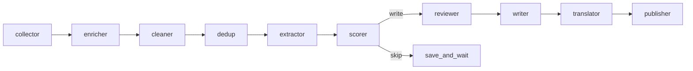

# Agent 评测方案

- **日期**：2026-09-07
- **状态**：方案已定，待实施
- **范围**：为本仓库的 LangGraph 新闻流水线建立可复现评测，不引入公开 Agent 基准

---

## 1. 决策

本项目不是对话 Agent，也不是工具循环 Agent。评测对象是一条多节点流水线：采集 → 富化 → 清洗 → 去重 → 抽取 → 评分选稿 → 事件合并 → 撰稿 / 翻译 / 落地版。

读者画像以 `tech-news` Profile 为准：业务 Agent 开发者，重点关注 Harness 方法论与模型产品能力、GitHub Trending 高相关开源（配额 ≤ 3）、一线实验室官方认知；排除预训练 / 后训练等训练向研究。

因此评测只回答四件事：

1. 该进日报的有没有漏
2. 不该进的有没有混进来
3. 同一事件有没有拆成多条
4. 摘要、翻译、落地版有没有编造

公开基准（GAIA、AgentBench、SWE-bench）不作为本仓库指标。现有 `tests/` 继续覆盖确定性逻辑；LLM 判断质量用独立黄金集 + 冻结快照，默认不进每次 CI。

---

## 2. 现状



| 层次 | 现状 | 缺口 |
|------|------|------|
| 单元测试 | 解析、选择规则、图编译、部分 Source | 不测 LLM 对错 |
| Prompt / Profile | `ai_filter`、extractor、scorer、reviewer、writer 均有明确规则 | 改 Prompt 后无回归数字 |
| 产出 | `output/ai-daily-*.md` / `-zh.md` / `-dev.md` | 无冻结输入，无法复跑对比 |
| 可观测性 | 日志 + `run_id` | 无按节点的 precision / recall |

关键代码入口：

- 图：[`src/graph/workflow.py`](../src/graph/workflow.py)
- 过滤：[`src/tools/ai_filter.py`](../src/tools/ai_filter.py)
- 抽取：[`src/agents/extractor.py`](../src/agents/extractor.py)
- 评分选稿：[`src/agents/scorer.py`](../src/agents/scorer.py)、[`profiles/tech-news/`](../profiles/tech-news/)
- 事件合并：[`src/agents/reviewer.py`](../src/agents/reviewer.py)
- 撰稿：[`src/agents/writer.py`](../src/agents/writer.py)

节点已经是 `*_node(state) -> dict`，评测应直接调用单节点，不必每次 compile 整图。

---

## 3. 原则

1. **按节点评，再评端到端。** 选稿错了，writer 再好也是错题作文。
2. **冻结输入。** 评测不打外网 Source；用 `evals/fixtures/` 里的 JSON。
3. **相对序重于绝对分。** `importance_score` / `ai_score` 允许 ±1，看档位和排序。
4. **固定模型。** 对比实验锁定 `OPENAI_MODEL` 与 temperature（线上已是 0）。
5. **pytest 与 LLM eval 分开。** CI 跑确定性测试；改 filter / scorer / profile 时再跑 `evals/run_eval.py`。
6. **先脚本，后平台。** LangSmith / Braintrust 可后接看 trace，不作为评测起步条件。

---

## 4. 分层指标

### 4.1 确定性节点（继续 pytest）

覆盖 collector / enricher / cleaner / 规则去重 / `_select_items` / reviewer 解析与保最高分 / publisher 落盘。

| 指标 | 说明 |
|------|------|
| 源覆盖 | 启用源是否都有条目或明确空结果 |
| 空内容率 | `content` 过短的比例 |
| 选择规则 | 阈值、分类配额、`max_items` 是否生效 |

### 4.2 AI 过滤（优先落地）

黄金集：80–150 条标题，每条 `keep` / `drop` + 理由标签（四柱之一 / 训练向 / 产品套壳 / 无关）。

| 指标 | 用途 |
|------|------|
| Precision / Recall / F1 | 总体质量 |
| 训练向误放进率 | 假阳性中最伤读者的一类 |
| 官方文误杀率 | 假阴性中最不可接受的一类 |
| 降级路径 F1 | LLM 不可用时关键词兜底 |

### 4.3 抽取

黄金集：30–50 条带正文 / abstract 的条目。

| 指标 | 用途 |
|------|------|
| JSON 解析成功率 | 契约稳定性 |
| 实体召回 | 公司、模型、产品名 |
| 训练向压分率 | 应落在 importance 1–3 的比例 |
| 档位一致率 | 高 / 中 / 低 三档，不要求分数逐点相等 |

### 4.4 评分与选稿（日报质量核心）

黄金集：同一批 `ExtractedItem`，人工标 `must_include` / `optional` / `must_drop`。标签与四柱对齐。

| 指标 | 用途 |
|------|------|
| 必选召回 | 漏掉官方 Agent 文 / 新模型 API 即失败 |
| 必丢精确 | 训练向、融资八卦、chatbot demo 不得入选 |
| Jaccard（入选 ID 集合） | 改 Prompt 后的漂移 |
| 分类配额违约次数 | GitHub Trending 是否超过 3 |
| 排序 Spearman | 相对重要性是否稳定 |
| 跨模型漂移 | 同一 fixture，不同 `OPENAI_MODEL` |

门槛建议（第一版，可调）：必选召回 ≥ 0.9，必丢不得入选，配额违约 = 0。

### 4.5 Reviewer 事件合并

黄金集：若干组「同一事件 3 源 + 2 条相近但不同论文」。

| 指标 | 用途 |
|------|------|
| 应合并组的合并率 | 日报是否重复 |
| 误合并率 | 不同论文被捏成一条 |
| 保留最高 `ai_score` | 与现有单测一致，LLM 路径也要满足 |

### 4.6 Writer / 翻译 / 落地版

用更强模型做 Judge + 少量人审。不用 BLEU。

Checklist（每条 0/1）：

- 事实是否只来自输入条目（无新数字、无新产品名）
- 每条是否带 AI Score 与可点击来源
- 专业版结构是否仍符合 Top Stories / Featured / Quick Bites
- 中英实体是否对齐
- 落地版是否有「开发能用上」，而不是空口号
- 落地版是否仍排除训练向内容

人审抽样：每次改 writer prompt 后通读 1 天产出，标「明显变差 / 持平 / 更好」。

### 4.7 端到端快照

从公认质量尚可的历史日报中挑 5–10 天，保存当天 `raw_items`（或 cleaner 之后的条目）为 `evals/fixtures/days/YYYY-MM-DD.json`。

复跑 enrich → writer（不打外网），对比：

- 入选条目 ID 的 Jaccard
- 必选 ID 是否仍在、必丢 ID 是否复现
- 专业版 / 中文版 / 落地版是否都落盘

---

## 5. 目录与运行约定

待实施的布局：

```
evals/
  fixtures/
    filter_titles.json
    score_items.json
    merge_groups.json
    extract_items.json
    days/2026-09-04.json
  run_eval.py
  reports/                 # gitignore，本地报告
```

Fixture 字段最小集：

**过滤**

```json
{
  "id": "hn:123",
  "title": "...",
  "label": "keep",
  "reason": "official_cognition"
}
```

**选稿**

```json
{
  "id": "github:org/repo",
  "item": {},
  "decision": "must_include",
  "pillar": "open_source_trending"
}
```

运行约定：

```bash
# 确定性测试（CI）
pytest tests/

# LLM 评测（改 filter / scorer / profile / writer 时手动跑）
python evals/run_eval.py --suite filter
python evals/run_eval.py --suite score
python evals/run_eval.py --suite merge
python evals/run_eval.py --suite e2e --day 2026-09-04
```

`run_eval.py` 应打印：套件名、模型名、各指标、未达门槛的条目 ID。报告写成 `evals/reports/<suite>-<timestamp>.md`。

---

## 6. 实施顺序

### 第一周：黄金集 + 离线脚本

1. 从 `output/ai-daily-*.md` 与近期 raw 日志里抽标题 / 条目，人工标注 filter 与 score 两套集。
2. 实现 `evals/run_eval.py` 的 `filter`、`score` 套件。
3. 改 `profiles/tech-news/*.md` 或 `ai_filter` Prompt 必须跑这两套。

### 第二周：合并、抽取、端到端

1. 补 `merge_groups` 与 1–2 天冻结快照。
2. Writer Judge checklist（可先人审，再上 LLM judge）。
3. 把「必选召回 / 必丢」写成脚本退出码，便于本地门禁。

### 明确不做

- 每次 GitHub Actions 全量打 LLM
- 用公开 Agent 基准当主指标
- 要求 importance 绝对分完全一致
- 只评最终 markdown 好不好读

---

## 7. 改动时该跑哪套

| 改动 | 必跑 |
|------|------|
| `src/tools/ai_filter.py`、过滤 Prompt | `filter` |
| `profiles/tech-news/`、`scorer.py` | `score` |
| `reviewer.py` | `merge` |
| `extractor.py` | `extract` |
| `writer.py` / translator | writer checklist + 1 天人审 |
| Source / cleaner / enricher | `pytest`；影响入选时再加 `e2e` |
| 换默认模型 | `filter` + `score` + 跨模型漂移 |

---

## 8. 验收

方案落地的最低完成标准：

- 存在 filter 与 score 两份黄金集，且 `run_eval.py` 能打出 precision / recall / 必选召回
- 改 `tech-news` Profile 可以靠数字判断是否回退，而不是只靠通读当天日报
- pytest 仍然只测确定性逻辑，CI 费用不变
